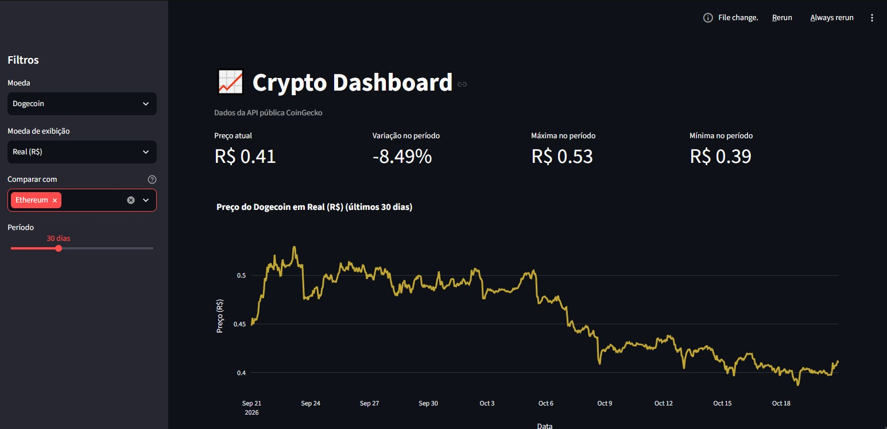

# 📈 Crypto Dashboard

Dashboard interativo para acompanhar preços, volume e performance de criptomoedas, construído com Python e Streamlit.

🔗 **Demo ao vivo:** [https://meu-app.streamlit.app](https://seu-app.streamlit.app)



## 🎯 O que o projeto faz

- Consulta preços históricos e volume de negociação via API pública CoinGecko
- Exibe métricas do período: preço atual, variação, máxima e mínima
- Permite alternar a moeda de exibição entre Dólar, Euro e Real
- Compara a performance de múltiplas criptomoedas usando **base 100** (normalização)
- Oferece tooltip detalhado com performance relativa e preço original
- Exporta os dados exibidos em CSV

## 🧠 Decisões técnicas

**Por que normalizar em base 100 na comparação?**
Comparar valores absolutos de BTC (milhares) com DOGE (centavos) torna o gráfico inútil. A normalização faz cada moeda começar em 100, permitindo comparar **performance relativa** de forma justa — a mesma métrica usada pelo mercado.

**Por que `@st.cache_data(ttl=400)`?**
A API do CoinGecko tem limite de requisições (429). O cache evita chamadas repetidas para a mesma combinação de moeda/periodo/moeda de exibição, melhorando performance e respeitando o rate limit.

**Por que cores fixas por moeda?**
Cada criptomoeda tem uma cor estável (Bitcoin laranja, Ethereum azul, etc.), mantendo consistência visual entre os gráficos e evitando que a cor mude a cada interação do usuário.

**Tratamento do erro 429**
Quando o limite é atingido, o app mostra uma mensagem amigável com opção de tentar novamente, em vez de um erro cru.

## 🛠️ Stack

- **Python 3.12+**
- **Streamlit** — interface web
- **Pandas** — manipulação de dados
- **Plotly** — gráficos interativos
- **Requests** — consumo da API CoinGecko

## 📁 Estrutura do projeto
crypto-dashboard/
├── app.py # Orquestração da interface
├── src/
│ ├── api.py # Funções de acesso à API
│ ├── config.py # Moedas, exibição e paleta
│ ├── cores.py # Cor estável por moeda
│ └── transformacoes.py # Normalização base 100
├── requirements.txt
├── .gitignore
└── README.md

## 🚀 Como rodar localmente

**Pré-requisitos:** Python 3.12+ e uma chave gratuita da [Demo API do CoinGecko](https://www.coingecko.com/en/developers/dashboard).

1. Clone o repositório:
   ```bash
   git clone https://github.com/seu-usuario/crypto-dashboard.git
   cd crypto-dashboard

2. Crie e ative o ambiente virtual:
    python -m venv venv
    # Windows
    venv\Scripts\activate
    # Mac/Linux
    source venv/bin/activate

3. Instale as dependências:
    pip install -r requirements.txt

4. Configure a chave da API:
    Crie o arquivo .streamlit/secrets.toml:
        COINGECKO_API_KEY = "sua_chave_aqui"

5. Rode o app:
    streamlit run app.py

## 🔐 Segurança

A chave da API não é versionada. O arquivo .streamlit/secrets.toml está no .gitignore. No deploy, a chave é configurada diretamente no painel do Streamlit Community Cloud.

## 📄 Licença

Este projeto está sob a licença MIT.